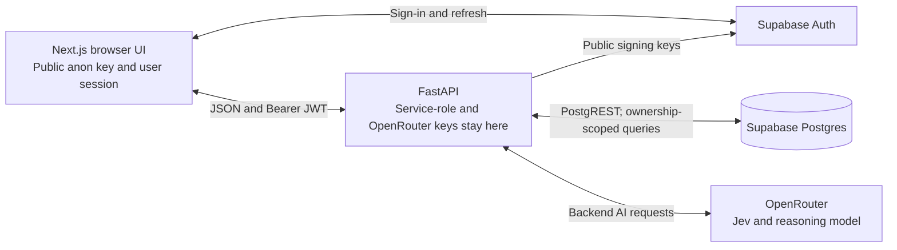

# Rhythm Health Lab

**Run personal experiments to learn which habits actually affect you.**

Ask a question like "Does walking after dinner improve my sleep?" and Rhythm turns it into a short experiment. It predicts what will change before you start. You log a 30-second check-in each day for 3 normal days and then 7 test days. At the end, a Lab Report puts the prediction next to what actually happened, and says honestly whether that was a signal or noise.

**Learning that sticks:** the lesson is about you, built from your own evidence. Making a prediction first turns the result into a surprise or a confirmation. The daily check-in is a small act, not reading. The timeline shows the evidence building up. More in [PRODUCT.md](PRODUCT.md).

## Team

| | Owns |
|---|---|
| **Nazmul** ([@mnahsanofficial](https://github.com/mnahsanofficial)) | Frontend and UI: visual direction, onboarding, dashboard, check-in, Lab Report, motion ([frontend/](frontend/)) |
| **Shakeb** | Backend and features: architecture, experiment model, AI design and prediction, analysis, data model ([backend/](backend/), [supabase/](supabase/)) |

Product decisions are made together ([PRD §27](PRD.md#27-team-ownership)).

## V1 status

Code checked **30 Oct 2026**, base `02b97d0`. **Done** means implemented in the cited code; automated and live-check evidence has separate limits below. Priorities come from [PRD §23](PRD.md#23-v1-scope); the dashboard gap comes from [§11](PRD.md#11-experiment-dashboard).

| Feature | Priority | Status | Implemented behavior / missing part |
|---|---|---|---|
| Persona creation | Must | Done | [Onboarding summary](frontend/components/onboarding/rhythm-summary.tsx) signs in/up and saves the profile |
| Natural-language question | Must | Done | [Shared form](frontend/components/experiments/question-form.tsx) accepts 5–500 characters on Your lab and `/experiments/new` via the [shared flow](frontend/components/experiments/experiment-flow.tsx) |
| AI-generated experiment | Must | Done | [Proposal pipeline](backend/app/services/proposal.py) classifies, safety-checks and designs the plan |
| Predictive forecast | Must | Done | [Preview](frontend/components/experiments/experiment-flow.tsx) shows a range, confidence, reasoning and uncertainty before start |
| One active experiment | Must | Done | [Database index](supabase/migrations/20261028000300_one_active_experiment_per_profile.sql) enforces it; the [UI preflight](frontend/components/experiments/experiment-flow.tsx) blocks a paid proposal while one is active |
| Short multi-day structure | Must | Done | [Designer](backend/app/services/experiment_designer.py) defaults to 3 baseline + 7 test days; [progress](backend/app/services/progress.py) uses saved durations |
| Manual daily check-ins | Must | Done | [Form](frontend/components/checkins/checkin-form.tsx) and [API](backend/app/api/checkins.py) record or replace today's metric values |
| Experiment timeline | Must | Done | [Timeline](frontend/components/experiments/experiment-progress.tsx) distinguishes recorded, missed, current and future days; recorded days open their answers |
| Lightweight N-of-1 analysis | Must | Done | [Python analysis](backend/app/services/analysis.py) calculates phase statistics, change, adherence, signal and forecast accuracy |
| Prediction vs actual | Must | Done | [Comparison reveal](frontend/components/report/prediction-vs-reality.tsx) reads the backend's structured prediction comparison |
| Interactive Lab Report | Must | Done | [Report](frontend/components/report/lab-report.tsx) shows calculated results and separately requests the written narrative |
| Experiment history | Must | Done | [History](frontend/components/experiments/experiment-history.tsx) lists completed experiments with each report's outcome |
| Prior results inform predictions | Must | Done | [History retrieval](backend/app/services/history.py) supplies up to five relevant completed experiments to the [designer](backend/app/services/experiment_designer.py) |
| Mobile-responsive experience | Must | Done | [Width checks](frontend/tests/e2e/layout-widths.spec.ts) cover public/private pages; screen/flow evidence is in [docs](docs/F2_F4_VERIFICATION.md) |
| Seeded completed experiment | Must | Done | [Demo reset](backend/app/services/demo.py) prepares a completed sample; [real-backend verification](docs/F2_F4_VERIFICATION.md) covers report/history and preserving the real active experiment |
| Notes/confounder logging | Should | Done | [Check-in note](backend/app/schemas/checkin.py) is stored and supplied to the [narrative writer](backend/app/services/report_writer.py) as context |
| Confidence explanation | Should | Done | [Forecast card](frontend/components/experiments/experiment-flow.tsx) displays confidence, reasoning and uncertainty factors |
| Suggested next experiment | Should | Done | [Written report](frontend/components/report/lab-report.tsx) offers a follow-up question that can prefill the next proposal |
| Safety checks | Should | Done | [Rules](backend/app/services/safety.py), [proposal checks](backend/app/services/proposal.py) and [report validation](backend/app/services/report_writer.py) guard generation; [limits](docs/ARCHITECTURE.md#guards-and-their-limits) remain |
| Interactive charts | Should | Done | [Day chart](frontend/components/report/day-chart.tsx) shows baseline/test values, skipped days and forecast band; tapping reveals values and notes |
| Dashboard, including primary-metric trend (§11) | Required screen | Partial | [Detail](frontend/components/experiments/experiment-detail.tsx) shows progress, prediction and recorded-day details; the across-days metric trend is missing |
| Edit generated plan before start | Nice | Not started | [Preview](frontend/components/experiments/experiment-flow.tsx) supports starting or asking again, without plan editing |
| Compare experiments | Nice | Not started | [History](frontend/components/experiments/experiment-history.tsx) lists individual results; no comparison view |
| Share/export Lab Report | Nice | Not started | [Report](frontend/components/report/lab-report.tsx) has no share/export action |
| Richer personal-pattern visualization | Nice | Not started | [History](frontend/components/experiments/experiment-history.tsx) has no aggregate patterns view |

**Demo and verification limits:** the [signed-in home](frontend/components/home-experience.tsx) keeps the real experiment/check-in visible and opens the question form in place. The [Demo entry](frontend/components/demo-entry.tsx) is `/demo`. Seed reset/report/history were checked against the real backend; early completion was checked with isolated backend-generated data, not a genuine live early finish ([evidence](docs/F2_F4_VERIFICATION.md)). The [keyboard-only onboarding test](frontend/tests/e2e/onboarding-experiment.spec.ts) remains skipped. Narrative-number verification is deferred; result figures use structured analysis/chart data, while generated prose can still quote numbers ([architecture](docs/ARCHITECTURE.md#guards-and-their-limits)).

**To confirm with Shakeb before merging:** live migration/grant state and the accepted report concurrency/persistence limits listed in the [backend review checklist](docs/ARCHITECTURE.md#backend-review-before-the-docs-pr-is-merged). Full backlog: [docs/REMAINING_WORK.md](docs/REMAINING_WORK.md).

## V2

Future directions, with their provenance. “Optional” or “deferred” does not commit a V2 delivery date.

| Direction | Source / scope |
|---|---|
| Health-data integration, especially Apple Health; keep manual subjective check-ins | **PRD V2:** [§25](PRD.md#25-v2) names sleep, steps, workouts and other health metrics |
| Reminder infrastructure | **PRD later:** [§22](PRD.md#22-notifications); push notifications remain outside initial V1 |
| Optional Google OAuth | **TRD later:** [authentication under §4](TRD.md#authentication) |
| Dedicated fitness/gym tracking | **Pair agreement:** Shakeb, call on **28 Oct**, supplied by Nazmul and [recorded here](docs/DECISIONS.md#v2-roadmap-inputs); detailed scope is not specified |
| Several active experiments at once | **Pair agreement:** call on **29 Oct**, supplied by Nazmul and [recorded here](docs/DECISIONS.md#v2-roadmap-inputs); requires coordinated database, backend and UI changes |
| Structured request logging; verification of numbers quoted in report prose | **Deferred engineering:** [DECISIONS Q12/Q17](docs/DECISIONS.md#questions-for-shakeb), time permitting; not promised V2 product features |

Magic-link sign-in remains skipped for V1; the full backend flow integration test remains a V1 wrap-up task ([DECISIONS Q12](docs/DECISIONS.md#questions-for-shakeb)). Existing [Claude suggestions](docs/REMAINING_WORK.md#suggestions) remain unapproved ideas, not roadmap commitments.

## Architecture



[Browser components](frontend/lib/api/client.ts) call FastAPI directly. Supabase handles sign-in/session refresh with `NEXT_PUBLIC_SUPABASE_ANON_KEY` ([auth client](frontend/lib/auth/supabase.ts)).
[FastAPI](backend/app/main.py) owns validation, lifecycle and analysis; `SUPABASE_SERVICE_ROLE_KEY` and `OPENROUTER_API_KEY` remain [backend settings](backend/app/config.py).
[Completion](backend/app/api/reports.py) is deterministic; the written report is generated separately from stored analysis. Localhost is the C2 demo target ([DECISIONS Q11](docs/DECISIONS.md#questions-for-shakeb)).
Diagrams, data model, AI budgets, code/TRD differences and test evidence: [docs/ARCHITECTURE.md](docs/ARCHITECTURE.md).

## Getting started

**Install JavaScript dependencies from the repository root with `npm ci`.** The root [lockfile](package-lock.json) covers every npm workspace; do not run a separate install in `frontend/`. Stop dev servers before migrating an existing checkout to the root install, then restart them afterward. After installing, the existing `npm run dev`, lint, typecheck and test commands still run from `frontend/`.

You need Node 22.18+, [uv](https://docs.astral.sh/uv/) and git, plus collaborator access to the repo and the env values from your teammate. Run these from a clean clone.

**1. Clone and set your git identity.** Agent logs record it.

```bash
git clone https://github.com/mnahsanofficial/rhythm-health.git
cd rhythm-health
npm ci
git config user.name "Your Name"
git config user.email "you@example.com"
```

Before your first agent session, also do the [teammate setup in docs/logging.md](docs/logging.md#teammate-setup).

**2. Backend** (http://localhost:8001):

```bash
cd backend
uv sync
cp .env.example .env.local
```

Fill in the values in `backend/.env.local`; see [docs/ENV_SETUP.md](docs/ENV_SETUP.md). Then start it:

```bash
uv run uvicorn app.main:app --reload --port 8001
```

Check `http://localhost:8001/health` returns `{"status":"ok"}`, and `http://localhost:8001/health/supabase` returns `{"status":"ok"}` once the Supabase values are right.

**3. Frontend** (http://localhost:3000), in a second terminal from the repo root:

```bash
cd frontend
cp .env.example .env.local
```

Set `NEXT_PUBLIC_SUPABASE_URL` and `NEXT_PUBLIC_SUPABASE_ANON_KEY` in `frontend/.env.local` before signing in. If either is blank, the app still loads and the sign-in page names the missing variable. Authentication is unavailable until both values are set. Then start it:

```bash
npm run dev
```

Open http://localhost:3000 and choose **Run your first experiment**.

Root `npm ci` installs exactly what's in `package-lock.json` without rewriting it. To add a frontend dependency, run `npm install <package> --workspace=rhythm-health-frontend` from the root.

The shared project's earlier migration setup is recorded in [DECISIONS Q1](docs/DECISIONS.md#questions-for-shakeb). For a new project, apply the [migrations](supabase/migrations/) including grants; Shakeb confirms the live schema.

## Running tests

From the root, `npm test` checks contract/brand freshness and runs the frontend, contract and brand suites. `npm run lint`, `npm run typecheck`, `npm run test:e2e` and `npm run build` delegate to the workspaces. Backend tests remain separate. Existing frontend commands below are unchanged.

After an API schema change, run `npm run contract:generate` from the root and commit the generated schema/types with the change. `npm run contract:check` fails if either differs from the current FastAPI code; it does not rewrite files. Both require `cd backend && uv sync` once, but never start the server, load real env files or contact Supabase/OpenRouter. Package details: [shared contract](packages/contract/README.md).

After a design-token change, edit `packages/brand/src/tokens.json`, run root `npm run brand:generate`, and commit the generated CSS. `npm run brand:check` rejects stale output. Native-ready numeric exports and web integration: [shared brand](packages/brand/README.md).

The suites mock Supabase and OpenRouter. Workspace verification on **31 Oct 2026**: **218 backend tests**, **138 frontend tests**, **6 contract-tool tests**, **11 brand-tool tests**, **73 browser tests passed; 1 existing browser skip**. Coverage, mock boundaries and limits: [architecture testing](docs/ARCHITECTURE.md#7-tests-and-current-evidence).

```bash
cd backend && uv run pytest           # backend: analysis, safety, progress, auth, endpoints
```

From `frontend/`:

```bash
npm run lint
npm run typecheck
npm test                              # Vitest + Testing Library + MSW
npx playwright install chromium       # once, before the first E2E run
npm run test:e2e                      # Playwright at 390px and 1440px, with mocked auth and API
npm run build
```

What each suite covers, and how to test by hand without spending AI credits or writing fake data: [docs/rules/testing.md](docs/rules/testing.md).

F2/F4 verification, including the live demo evidence, isolated early-finish fixture generator, timezone cases and local-only manual API: [docs/F2_F4_VERIFICATION.md](docs/F2_F4_VERIFICATION.md).

## Project structure

The npm workspaces are `frontend/`, `packages/contract/` and `packages/brand/`. The approved Expo app will be added under `apps/mobile/` after the shared-package PR merges. The backend stays a separate uv project. The [folder map](docs/ARCHITECTURE.md#6-project-structure) covers the Next.js UI/data layer, FastAPI routes/services/repositories, SQL migrations and both test trees.

## Documentation

| File | What it is |
|---|---|
| [AGENTS.md](AGENTS.md) | The entry point for every coding agent: non-negotiables and the rules index ([CLAUDE.md](CLAUDE.md) adds the Claude Code specifics) |
| [PRODUCT.md](PRODUCT.md) | One-page product summary |
| [PRD.md](PRD.md) / [TRD.md](TRD.md) | Full product requirements and technical architecture |
| [DESIGN.md](DESIGN.md) | Design tokens and component conventions |
| [docs/ARCHITECTURE.md](docs/ARCHITECTURE.md) | Implemented system, sequence and data diagrams; AI budgets, decisions, tests and backend review checklist |
| [docs/DECISIONS.md](docs/DECISIONS.md) | Decisions, deferred work and the supplied V2 call agreements |
| [docs/REMAINING_WORK.md](docs/REMAINING_WORK.md) | What's done, what's left, bugs and risks |
| [docs/ENV_SETUP.md](docs/ENV_SETUP.md) | Every environment variable, by name |
| [docs/rules/](docs/rules/) | Git workflow, secrets, API contracts, testing, UI quality, health content |
| [docs/logging.md](docs/logging.md) | How agent session logging works, and teammate setup |

## How we work

- **Branches:** one per feature, cut from `main` (`feat/…`, `fix/…`, `docs/…`, `test/…`, `chore/…`). Never commit to `main`.
- **Commits:** Conventional Commits, such as `feat(frontend): add the daily check-in screen`.
- **PRs:** a short description of what changed and how it was tested by hand. Merged with a **merge commit**, never squashed or rebased, so each person's commits and logs stay visible.
- **Session logs:** every agent session writes to `.claude-logs/` through hooks, and the logs are committed with the work.
- **AI tools:** Claude Code and Codex.
- **Secrets:** they stay in `.env.local`. None go in prompts, logs or commits.

Details: [docs/rules/git-workflow.md](docs/rules/git-workflow.md).

---

Built during **8x Playmakers C2**, track "Health habits", theme "Learning that sticks", by **Team F**.
