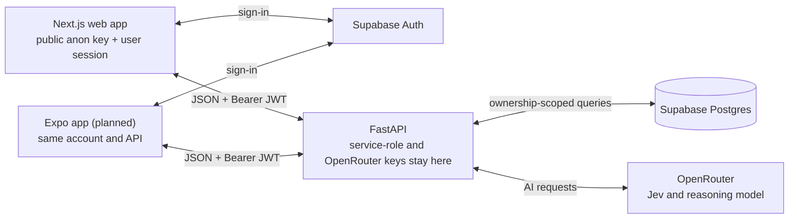

# Rhythm Health Lab

**Run personal experiments to learn which habits actually affect you.**

Ask a question like "Does walking after dinner improve my sleep?" and Rhythm turns it into a short experiment. It predicts what will change before you start, you log a 30-second check-in each day (3 normal days, then 7 test days), and a Lab Report puts the prediction next to what actually happened, saying honestly whether it was a signal or noise.

**Learning that sticks:** the lesson is about you, built from your own evidence. Predicting first turns the result into a surprise or a confirmation. The daily check-in is a small act, not reading, and the timeline shows the evidence building up. More in [PRODUCT.md](PRODUCT.md).

## Why we're moving to mobile

At the 30 Oct feedback call, reviewers told us that tracking something every day on a website doesn't make sense for a 10-day experiment. They were right. People have to remember to open a site, they drop off, and a missed day weakens their result.

**Our decision:** an Expo app for the daily loop: **today, check-in, progress and a daily reminder**. Onboarding, experiment design and the full Lab Report stay on the web for now. The plan, screens and risks are in [docs/MOBILE_PLAN.md](docs/MOBILE_PLAN.md).

**What we did first**, so both apps share one set of rules:

- **Shared packages (#30, #32):** `packages/contract`, API types generated from the FastAPI schema, and `packages/brand`, design tokens for web and native.
- **Progress endpoint (#33):** the backend now decides which days are recorded or missed and when the next day opens ([docs/PROGRESS_API.md](docs/PROGRESS_API.md)).
- **Web calendar reminder (#29):** a stopgap until the app's reminder works.

## Status

Checked against `main` on **31 Oct 2026**. Details, owners and the plan to Thursday: [docs/REMAINING_WORK.md](docs/REMAINING_WORK.md).

| | Done | In progress | Next |
|---|---|---|---|
| **Web** | The full core loop: onboarding → question → prediction → start → daily check-ins → timeline → finish → Lab Report with the written narrative → next experiment. Also history, the seeded demo and the calendar reminder | | Clean-up (dead code, one percent formatter); the report chart's `missed` flag |
| **Backend** | Auth, profile, propose (with past experiments as context), check-ins, deterministic analysis, report narrative, demo reset, progress endpoint | | `missed` flag on chart points; scale words for check-in metrics; full-flow test |
| **Mobile** | Shared types, native type styles and the progress endpoint it needs | Expo app: sign in, Today, Check-in, reminder, Progress | Reading the Lab Report and history on the phone (V2) |

## Architecture



The clients never talk to the database or OpenRouter directly. **AI proposes, Python measures:** results come from deterministic analysis, never from model prose. Details: [docs/ARCHITECTURE.md](docs/ARCHITECTURE.md).

## Getting started

**Prerequisites:** Node 22.18+, [uv](https://docs.astral.sh/uv/), git and collaborator access. Before your first agent session, do the [teammate setup in docs/logging.md](docs/logging.md#teammate-setup).

**1. Clone and install.** Install JavaScript dependencies once, from the repository root; don't install separately in `frontend/`.

```bash
git clone https://github.com/mnahsanofficial/rhythm-health.git
cd rhythm-health
npm ci
(cd backend && uv sync)
```

**2. Env files.** Copy `backend/.env.example` to `backend/.env.local` and `frontend/.env.example` to `frontend/.env.local`, then fill them in. Every variable is listed by name in [docs/ENV_SETUP.md](docs/ENV_SETUP.md); get the values from your teammate privately.

**3. Backend** (http://localhost:8001):

```bash
cd backend
uv run uvicorn app.main:app --reload --port 8001
```

To test from a phone on the same Wi-Fi, listen on every network interface instead. Do this only on a network you trust, because it makes the API reachable from other devices:

```bash
cd backend
uv run uvicorn app.main:app --reload --host 0.0.0.0 --port 8001
```

`http://localhost:8001/health` should return `{"status":"ok"}`, and `/health/supabase` too once the Supabase values are right.

**4. Web app** (http://localhost:3000), in a second terminal:

```bash
cd frontend
npm run dev
```

Open http://localhost:3000 and choose **Run your first experiment**.

**Mobile app (coming next).** It will live in `apps/mobile/` and run on a phone with Expo Go against the backend above. Its commands will be added here when the app exists; until then, see [docs/MOBILE_PLAN.md](docs/MOBILE_PLAN.md).

## Running tests

None of these call Supabase or OpenRouter. From the repository root:

```bash
npm run lint
npm run typecheck
npm test
npm run build
```

`npm test` first checks that the generated contract and brand files are current, then runs the frontend, contract and brand suites. Browser tests (install Chromium once):

```bash
cd frontend
npx playwright install chromium
cd ..
npm run test:e2e
```

Backend tests:

```bash
cd backend
uv run pytest
```

Last full run on **31 Oct 2026**: 243 backend, 157 frontend, 11 brand and 6 contract tests, and 76 browser tests plus 1 existing skip. After a backend schema change, run `npm run contract:generate`; after a token change, `npm run brand:generate`. More: [docs/rules/testing.md](docs/rules/testing.md).

## Project structure

| Folder | What it is |
|---|---|
| [frontend/](frontend/) | Next.js web app |
| [backend/](backend/) | FastAPI app (a separate uv project) |
| [supabase/](supabase/) | Database migrations and row-level security |
| [packages/contract/](packages/contract/) | API types generated from the FastAPI schema, shared by web and mobile |
| [packages/brand/](packages/brand/) | Design tokens: generated web CSS and native-ready values |
| `apps/mobile/` | The Expo app (planned; see [MOBILE_PLAN.md](docs/MOBILE_PLAN.md)) |
| [docs/](docs/) | Plans, decisions, rules, architecture and evidence |

## Documentation

| File | What it is |
|---|---|
| [AGENTS.md](AGENTS.md) | Entry point for every coding agent: non-negotiables and the rules index |
| [PRODUCT.md](PRODUCT.md), [PRD.md](PRD.md), [TRD.md](TRD.md) | Product summary, full requirements, technical design |
| [DESIGN.md](DESIGN.md) | Design tokens, layout and the "Ours, not AI-default" rules |
| [docs/MOBILE_PLAN.md](docs/MOBILE_PLAN.md) | The mobile app's V1 scope, screens, risks and build order |
| [docs/REMAINING_WORK.md](docs/REMAINING_WORK.md) | Status, owners, feedback, the plan to Thursday and suggested features |
| [docs/ARCHITECTURE.md](docs/ARCHITECTURE.md) | The system as built: diagrams, data model, AI costs, tests |
| [docs/PROGRESS_API.md](docs/PROGRESS_API.md) | Day states, counts and the next opening, for web and mobile |
| [docs/DECISIONS.md](docs/DECISIONS.md) | Decisions and answered questions |
| [docs/ENV_SETUP.md](docs/ENV_SETUP.md) | Every environment variable, by name |
| [docs/rules/](docs/rules/) | Git workflow, pair rule, secrets, API contracts, testing, UI quality, motion, health content |
| [docs/logging.md](docs/logging.md) | How agent session logging works, and teammate setup |

## How we work

- **Split by feature:** both of us work across frontend, backend and database. If your PR changes the other person's area, tell them in the team chat when it opens. Never apply a migration to the shared Supabase project without telling the other person first ([pair rule](docs/rules/pair-rule.md)).
- **Branches and PRs:** one branch per feature, cut from `main`. Before opening a PR, merge the latest `origin/main` and rerun the checks. Merged with a **merge commit**, never squashed, so each person's work stays visible ([git workflow](docs/rules/git-workflow.md)).
- **Agents:** Claude Code and Codex commit, push their own branches and open PRs; Nazmul reviews and merges. Agents never merge, force-push or push to `main`. Cursor isn't cleared for agent work until its logging canary passes ([logging](docs/logging.md)).
- **Session logs:** every agent session writes to `.claude-logs/` through hooks, and the logs are committed with the work.
- **Secrets:** only in `.env.local`, never in prompts, logs or commits.

## Team

V1 was split by layer. V2 is split by feature:

| | V2 features |
|---|---|
| **Nazmul** ([@mnahsanofficial](https://github.com/mnahsanofficial)) | The mobile app's daily loop (Today, Check-in, Progress, reminders); the web's daily loop and design system; the shared packages and the progress endpoint |
| **Shakeb** | Experiment intelligence: proposals and predictions (with past experiments), analysis and the Lab Report narrative, the demo seed, and new data the apps need (chart `missed` flag, scale words) |

Product decisions are made together ([PRD §27](PRD.md#27-team-ownership)).

---

Built during **8x Playmakers C2**, track "Health habits", theme "Learning that sticks", by **Team F**.
