# Rhythm Health Lab

Rhythm is a phone app that turns a question about one of your habits into a short personal experiment.
It predicts what will change, you check in for 30 seconds a day for 10 days, and Python measures what actually happened.
The Lab Report then says honestly whether it was a signal or noise, so the lesson comes from your own evidence.

Built for **8x Playmakers C2**, track "Health habits", theme "Learning that sticks", by **Team F**.

**Reviewing this?** Start with the one-page [final status](docs/FINAL_STATUS.md), then [Architecture](docs/ARCHITECTURE.md), the [decision records](docs/adr/README.md) and the [8x feedback tracker](docs/FEEDBACK_TRACKER.md). All the docs are listed in the [docs index](docs/README.md).

## Screenshots

These are from the mobile app, with labelled sample data.

| | Landing | Today | Check-in | The reveal | Lab Report |
|---|---|---|---|---|---|
| **Light** | 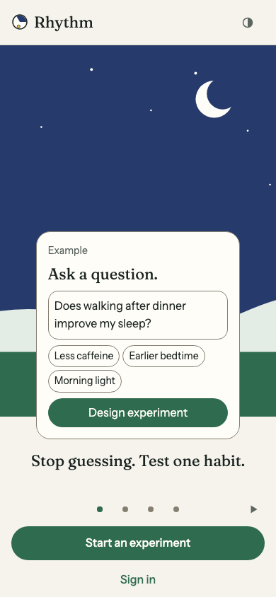 | 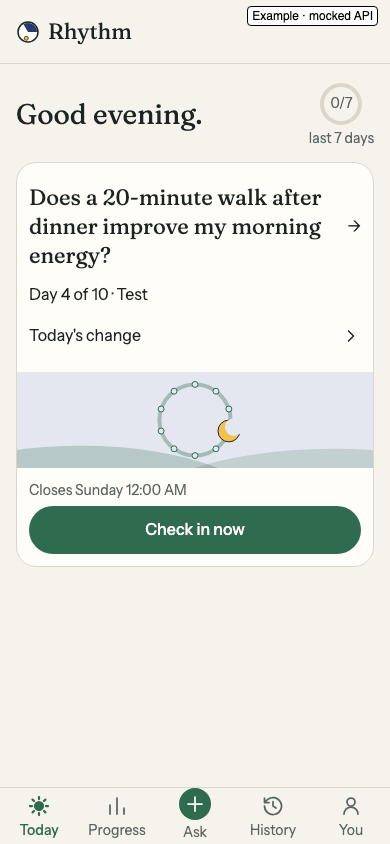 | 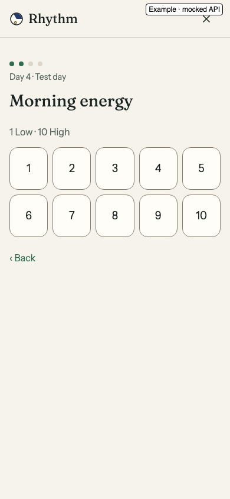 | 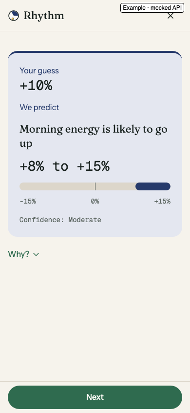 | 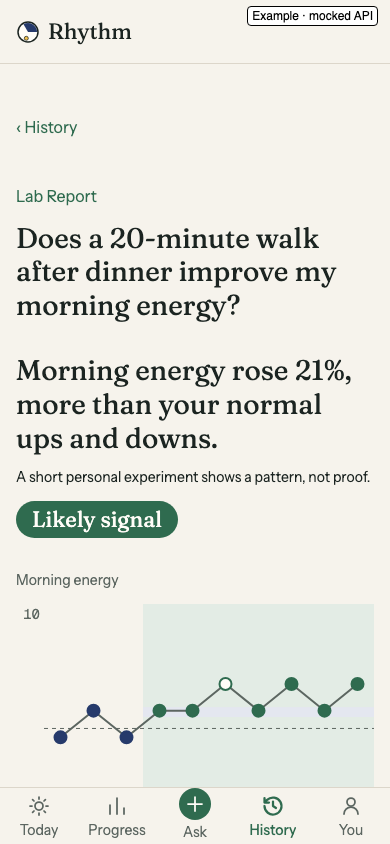 |
| **Dark** | 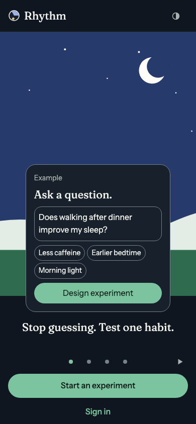 | 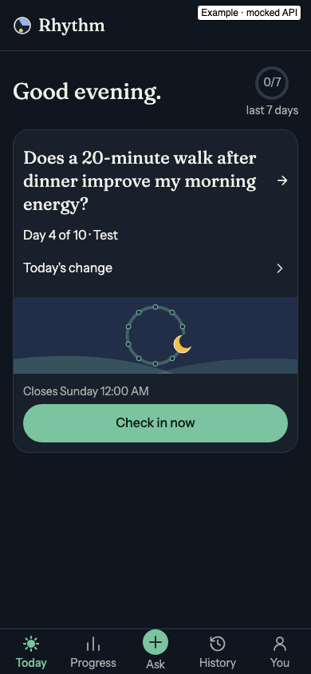 | 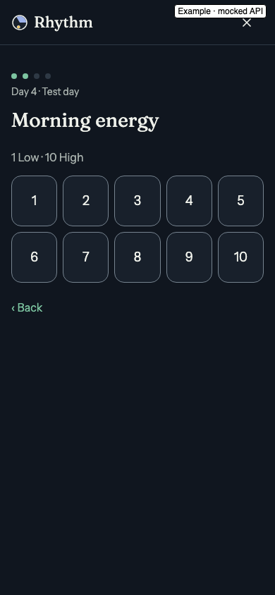 | 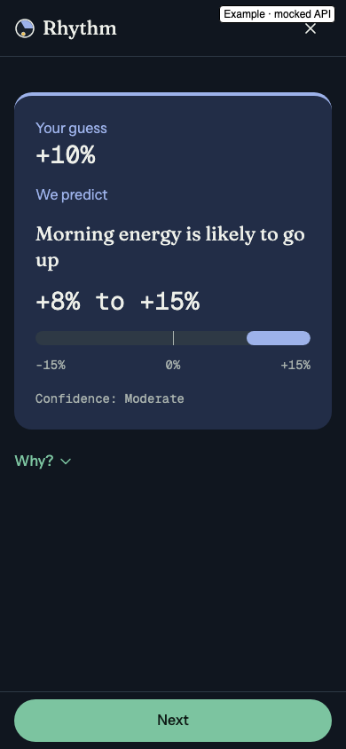 | 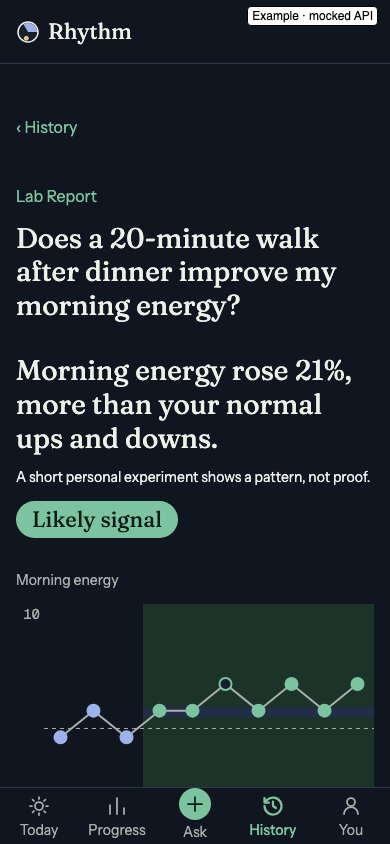 |

## Features

**Mobile (the product):**
- Sign up and seven-question onboarding, with a live scene on each step
- Ask any habit question in your own words; safety rules and AI check it, and a plan comes back
- A plan in four short steps: the change, your guess, the reveal, then your 10 days
- Lock in your own guess before the AI forecast is revealed
- Run up to 3 experiments at once, with one combined check-in, and see overlap in the report
- A short daily check-in, one question per screen, using the experiment's own questions
- Local reminders that name the day, never the habit
- "Your test starts tomorrow" on day 3, and your own normal shown on day 4
- A Lab Report that opens with one plain sentence, the chart and prediction against reality, with "How we know" and the details one tap away
- A Day 10 choice: keep the habit, try a variation or test something new
- History, a comparison on Progress, and how close your guesses are getting
- Word budgets on every main screen, enforced by a test ([why](docs/design/07-feedback-5-nov.md))
- Light and dark themes, motion that respects Reduce Motion, and clearly labelled samples

**Web:** the same account and core loop, with a desktop Today dashboard and stepped daily check-ins now merged. The four-step plan and fuller habit/safety question choices are review work; later report, outcome, Progress and landing parity is deferred. [Current status](docs/FINAL_STATUS.md#web-parity-handover--6-nov) · [Design decisions and screenshots](docs/design/08-web-parity.md) · [Desktop/mobile differences](docs/ARCHITECTURE.md#8-deliberate-web-and-mobile-differences).

**Under the hood:** AI proposes and Python measures; a daily cap on paid AI calls; shared generated API types and design tokens; CI on every PR.

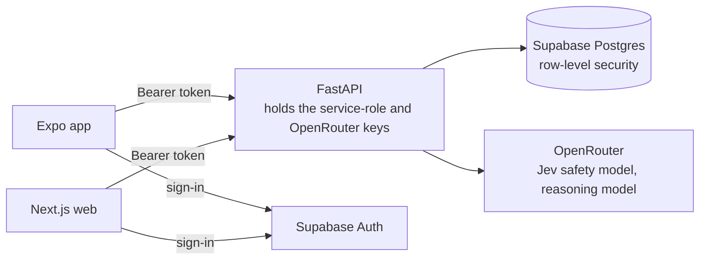

## Run it

You need Node 22.18+, [uv](https://docs.astral.sh/uv/), and for the app, an iPhone with Expo Go on the same Wi-Fi.

```bash
git clone https://github.com/mnahsanofficial/rhythm-health.git
```

```bash
cd rhythm-health && npm ci && (cd backend && uv sync)
```

Then copy each `.env.example` to `.env.local` in `backend/`, `frontend/` and `apps/mobile/`, and fill them in. Every variable is listed by name in [docs/ENV_SETUP.md](docs/ENV_SETUP.md). Get the values privately, and never paste them into a prompt or log.

**Backend** (`http://localhost:8001`). `--host 0.0.0.0` lets the phone reach it, so use it only on a network you trust:

```bash
cd backend && uv run uvicorn app.main:app --reload --host 0.0.0.0 --port 8001
```

**Mobile**, in a second terminal. Scan the QR code with your iPhone. `EXPO_PUBLIC_API_URL` must use your Mac's network address ([setup](apps/mobile/README.md)):

```bash
npm run start --workspace=@rhythm-health/mobile
```

**Web** (`http://localhost:3000`), in a third:

```bash
cd frontend && npm run dev
```

**Checks**, none of which call Supabase or OpenRouter. CI runs all of them on every PR ([testing](docs/rules/testing.md)):

```bash
npm run lint && npm run typecheck && npm test && npm run build
```

```bash
npm run test:e2e
```

```bash
cd backend && uv run pytest
```

## Demo path

About 3 minutes, on the phone. Steps marked *paid* make a real AI call.

1. **Landing:** swipe through, then choose to get started.
2. **Sign up and onboard:** seven questions, then your rhythm summary. Email confirmation may be on, so check before a live demo.
3. **See a result right away:** on an empty Today or History, choose **Explore a completed example**. It's a labelled sample with no AI call: one plain sentence, the chart, then prediction, reality and guess.
4. **The daily loop:** on an empty Today, **Try a sample** starts a labelled experiment on day 5 of 10, with no AI call. Do its 30-second check-in and see the celebration. Remove it afterwards to free its slot.
5. **Ask:** type a habit question and send it. *Paid: normally 2 calls.*
6. **Plan and guess:** read the plan, lock in a guess, then reveal the forecast and start.
7. **Theme:** switch between light and dark under You.

## How we work

- **A branch and a PR per feature, with merge commits,** never squashed, because each person's work has to stay visible ([git workflow](docs/rules/git-workflow.md)).
- **Every agent session is logged** to [`.claude-logs/`](.claude-logs/) by hooks, and CI checks the format ([logging](docs/logging.md)).
- **Secrets stay in `.env.local`** ([secrets](docs/rules/secrets.md)).
- **No calorie counting, weight targets or medical claims** ([health content](docs/rules/health-content.md)).

Agents start at [AGENTS.md](AGENTS.md). V1 was split by layer, and V2 by feature, across frontend, backend and database ([pair rule](docs/rules/pair-rule.md)).

**Team:** Nazmul ([@mnahsanofficial](https://github.com/mnahsanofficial)) and Shakeb.
