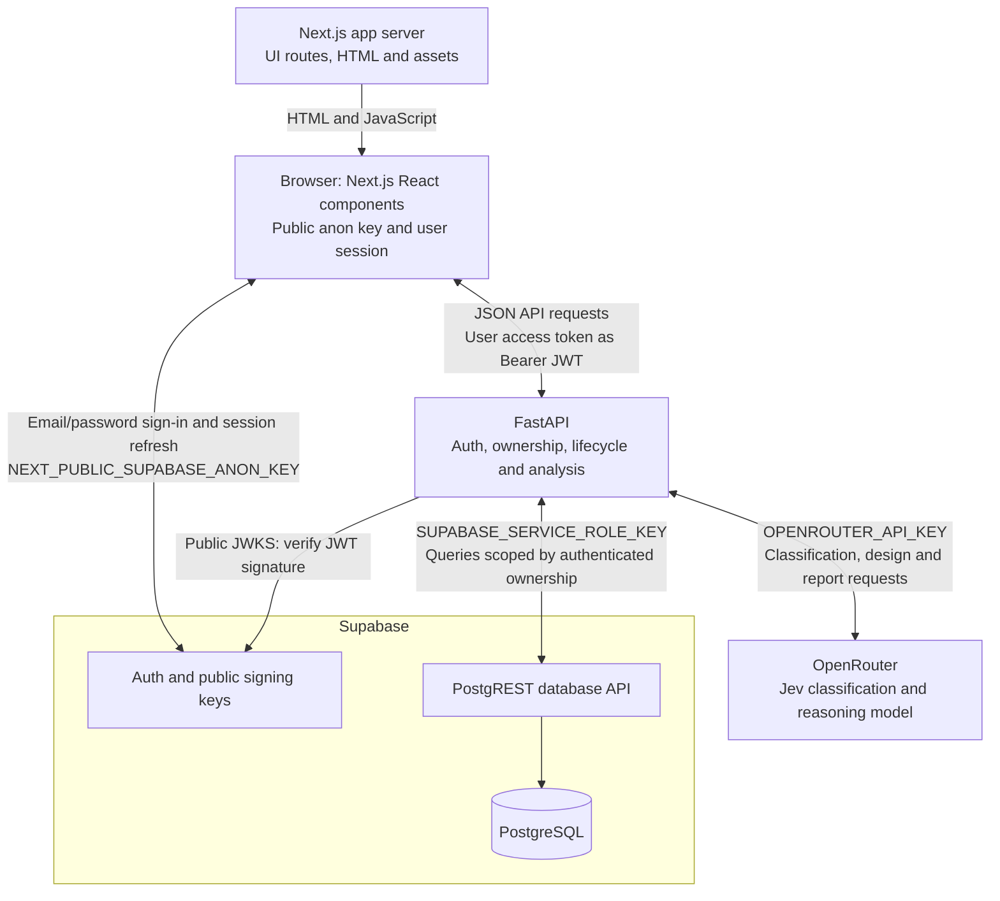
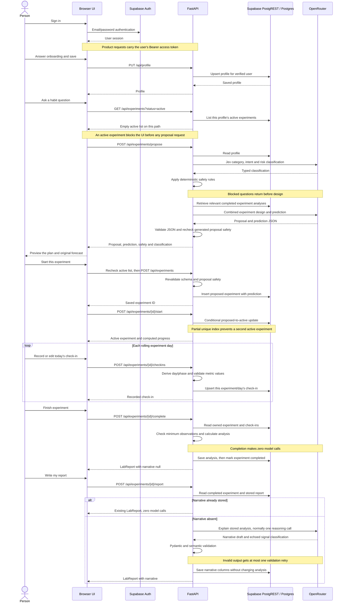
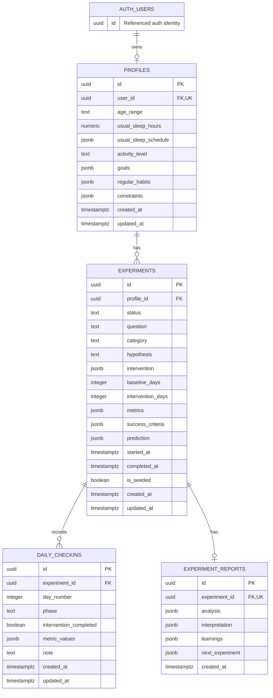

# Architecture as implemented

Checked **30 Oct 2026** against `origin/main` at `02b97d0`, on `docs/architecture-v1-v2`. Native type styles, review notes and test evidence updated **31 Oct 2026** on `chore/brand-native-tokens`, based on `origin/main` at `891d1aa`. Progress API and web consumers updated **31 Oct 2026** on `feat/progress-endpoint`, based on `origin/main` at `65bc328`. This describes the checked-in implementation, not a deployed service or the PRD/TRD's planned architecture. Product decisions are recorded in [DECISIONS.md](DECISIONS.md); known gaps and live-check limits are in [REMAINING_WORK.md](REMAINING_WORK.md) and [F2_F4_VERIFICATION.md](F2_F4_VERIFICATION.md).

## 1. System overview and trust boundaries

**Sources for the diagram:** [frontend routes](../frontend/app/), [browser API client](../frontend/lib/api/client.ts), [Supabase browser client](../frontend/lib/auth/supabase.ts), [FastAPI composition and CORS](../backend/app/main.py), [JWT verification](../backend/app/auth/supabase.py), [PostgREST client](../backend/app/integrations/supabase.py) and [OpenRouter client](../backend/app/integrations/openrouter.py).

- The frontend is Next.js 16 with React 19. App Router pages render the UI; browser components call FastAPI directly through `lib/data/*` and `lib/api/client.ts`. There is no Next.js product-API proxy in the current [route tree](../frontend/app/). Versions are in [package.json](../frontend/package.json); Cache Components and partial prefetching are enabled in [next.config.ts](../frontend/next.config.ts).
- The browser's application key is `NEXT_PUBLIC_SUPABASE_ANON_KEY`. It also holds the signed-in user's access/refresh session, managed by the Supabase SDK; an access token is a user credential, not a backend service key. Public service locations use `NEXT_PUBLIC_SUPABASE_URL` and `NEXT_PUBLIC_API_URL`. No service-role or OpenRouter key is referenced by the [browser auth client](../frontend/lib/auth/supabase.ts) or [API client](../frontend/lib/api/client.ts).
- `SUPABASE_SERVICE_ROLE_KEY` and `OPENROUTER_API_KEY` are backend settings. The service role bypasses RLS, so FastAPI must verify ownership before repository access. JWT verification checks an asymmetric signature, issuer, expiry and the authenticated audience; the user comes from `sub`. Profile IDs come from that user, not request bodies. Sources: [settings](../backend/app/config.py), [auth](../backend/app/auth/supabase.py), [ownership dependencies](../backend/app/api/deps.py), [profile repository](../backend/app/repositories/profiles.py) and [experiment repository](../backend/app/repositories/experiments.py).
- Product routes depend on authenticated users. `/health` and `/health/supabase` are public operational checks; the latter calls PostgREST. CORS is configured by `CORS_ORIGINS`. Sources: [main.py](../backend/app/main.py), [API routers](../backend/app/api/) and [database integration](../backend/app/integrations/supabase.py).

## 2. Core loop

This sequence follows a signed-in user with no active experiment and an allowed question. Onboarding may also happen before sign-up: answers stay on the device until the summary obtains a session and saves the profile. Sources: [onboarding flow](../frontend/components/onboarding/onboarding-flow.tsx), [local draft](../frontend/lib/onboarding/draft.ts), [summary/save](../frontend/components/onboarding/rhythm-summary.tsx) and [auth form](../frontend/components/auth/auth-form.tsx).

**Sources for the sequence:** [profile endpoint](../backend/app/api/profile.py), [frontend experiment flow](../frontend/components/experiments/experiment-flow.tsx), [experiment endpoints](../backend/app/api/experiments.py), [proposal orchestration](../backend/app/services/proposal.py), [check-in endpoint](../backend/app/api/checkins.py), [report endpoints](../backend/app/api/reports.py) and [frontend report actions](../frontend/lib/data/reports.ts).

Operational details visible in the implementation:

- Proposal generation does not persist an experiment. Save and start are separate requests; the UI retains a saved ID so a failed start can be retried without another save. The active preflight protects the UI from unnecessary paid proposals; the backend `/propose` route itself does not enforce the active limit. Start enforces it through a precheck, conditional update and database index. Sources: [experiment flow](../frontend/components/experiments/experiment-flow.tsx), [proposal service](../backend/app/services/proposal.py), [experiment API](../backend/app/api/experiments.py), [repository](../backend/app/repositories/experiments.py), [active index migration](../supabase/migrations/20261028000300_one_active_experiment_per_profile.sql).
- Check-in bodies contain metric values, an optional intervention answer and a note. The server derives day and phase, validates required/unknown metric keys and bounds, and permits writes only during the current active day. A missed past day cannot be backfilled through this API. Sources: [check-in schemas](../backend/app/schemas/checkin.py), [endpoint](../backend/app/api/checkins.py) and [metric validation](../backend/app/services/checkins.py).
- Web home and detail read `GET /api/experiments/{id}/progress` for authoritative day states, counts and the next opening timestamp. It reuses rolling progress and adherence analysis; early-finished unobserved days never become missed. No migration, writes or model calls are needed. Sources: [timeline service](../backend/app/services/timeline.py), [web data layer](../frontend/lib/data/experiments.ts) and [progress contract](PROGRESS_API.md).
- Completion needs `min(2, baseline_days)` baseline observations and `min(3, intervention_days)` test observations. It saves analysis and changes status in separate database requests, not one database transaction. A second completion returns 409. Sources: [analysis](../backend/app/services/analysis.py), [completion endpoint](../backend/app/api/reports.py), [report repository](../backend/app/repositories/reports.py) and [experiment repository](../backend/app/repositories/experiments.py).
- History lists completed experiments, then fetches each report independently. `/demo` calls authenticated `POST /api/demo/reset`, replacing only this profile's seeded rows with a stable experiment ID, ten check-ins, computed analysis and a fixed narrative. It makes no model call and preserves non-seeded experiments. Sources: [history UI](../frontend/components/experiments/experiment-history.tsx), [demo UI](../frontend/components/demo-entry.tsx), [demo endpoint](../backend/app/api/demo.py), [reset service](../backend/app/services/demo.py) and [seed definitions](../backend/app/demo/seed.py).
- Normal experiments have no abandon/delete endpoint. The normal route transitions are save, start and complete; demo reset's deletion filter matches seeded rows only. Sources: [experiment API](../backend/app/api/experiments.py), [report API](../backend/app/api/reports.py) and [seed deletion](../backend/app/repositories/experiments.py).

## 3. Data model and database-enforced rules

Four application tables reference Supabase's existing `auth.users` table, shown as `AUTH_USERS`; the other diagram nodes map to the lowercase table names in `public`. The diagram lists their main persisted columns; computed `progress` and API `chart`/`narrative` objects are not additional tables. The migrations reference the auth identity but do not define the external auth table. Sources: [profile migration](../supabase/migrations/20261028000000_create_profiles.sql), [experiment migration](../supabase/migrations/20261028000200_create_experiments.sql), [check-in migration](../supabase/migrations/20261028000400_create_daily_checkins.sql), [report migration](../supabase/migrations/20261028000500_create_experiment_reports.sql), [progress builder](../backend/app/services/progress.py) and [Lab Report builder](../backend/app/services/lab_report.py).

| Enforced by migrations | Boundary / source |
|---|---|
| One profile per auth user; foreign keys cascade deletes through the ownership tree | [profiles](../supabase/migrations/20261028000000_create_profiles.sql), [experiments](../supabase/migrations/20261028000200_create_experiments.sql), [check-ins](../supabase/migrations/20261028000400_create_daily_checkins.sql), [reports](../supabase/migrations/20261028000500_create_experiment_reports.sql) |
| Experiment status is one of `draft`, `proposed`, `active`, `completed`; phase lengths must be positive | [experiment migration](../supabase/migrations/20261028000200_create_experiments.sql). The save API currently inserts `proposed`, not `draft`: [endpoint](../backend/app/api/experiments.py) |
| At most one active experiment per profile, even under concurrent starts | Partial unique [active index](../supabase/migrations/20261028000300_one_active_experiment_per_profile.sql) |
| One check-in per `(experiment_id, day_number)`; positive day number; phase is `baseline` or `intervention` | [check-in migration](../supabase/migrations/20261028000400_create_daily_checkins.sql). JSON metric semantics and the valid current day are enforced by [Python](../backend/app/api/checkins.py), not SQL |
| At most one report per experiment; `analysis` is required; narrative columns may be null | [report migration](../supabase/migrations/20261028000500_create_experiment_reports.sql). [Narrative mapping](../backend/app/services/lab_report.py) stores summary/interpretation/confounders inside `interpretation`, personal learnings in `learnings`, and the suggestion in `next_experiment` |
| RLS on all four application tables; authenticated users can read only their ownership tree | Policies in the four table migrations above. Authenticated users also have insert/update permission on their own profile via [profile grants](../supabase/migrations/20261028000100_grant_profiles_privileges.sql); experiment/check-in/report writes are service-role only |
| Update timestamps on profiles, experiments and check-ins | `set_updated_at` in [profiles](../supabase/migrations/20261028000000_create_profiles.sql), reused by [experiments](../supabase/migrations/20261028000200_create_experiments.sql) and [check-ins](../supabase/migrations/20261028000400_create_daily_checkins.sql). Reports have only `created_at` |

Prediction immutability is an API/access-control boundary: the normal API has no plan/prediction editing endpoint, and authenticated database clients cannot update experiments. There is no SQL trigger that freezes prediction JSON against service-role writes. Sources: [experiment API](../backend/app/api/experiments.py) and [experiment migration](../supabase/migrations/20261028000200_create_experiments.sql).

## 4. AI pipeline, cost and numerical authority

Jev uses `OPENROUTER_JEV_MODEL` through OpenRouter's typed Decisions API for category, intent and risk. Design/prediction and report writing use `OPENROUTER_REASONING_MODEL` through structured chat completions. All use backend `OPENROUTER_API_KEY`; the configured runtime model IDs are not asserted here. Sources: [settings](../backend/app/config.py), [Jev integration](../backend/app/integrations/jev.py), [OpenRouter transport](../backend/app/integrations/openrouter.py), [designer](../backend/app/services/experiment_designer.py) and [report writer](../backend/app/services/report_writer.py).

### Paid requests per user action

These are outbound request counts, not a guarantee about provider billing for failed requests. A validation retry is another paid-capable request. Transport failures return an error rather than receiving the same validation retry. Sources: [OpenRouter retry loop](../backend/app/integrations/openrouter.py) and [Jev fallback](../backend/app/integrations/jev.py).

| Action | Normal outbound model requests | Extra paths in code | Source |
|---|---|---|---|
| Propose an allowed question | 2: one Jev classification, one combined design/prediction | Invalid design output adds one retry. Failed/invalid Jev adds reasoning fallback (1–2 requests). Maximum through these branches: 5 requests including the original Jev attempt | [proposal](../backend/app/services/proposal.py), [Jev](../backend/app/integrations/jev.py), [designer](../backend/app/services/experiment_designer.py), [transport](../backend/app/integrations/openrouter.py) |
| Block before design | 1 classification request; no design | A Jev failure can still invoke the 1–2-request fallback before the safety decision | [proposal order](../backend/app/services/proposal.py), [safety](../backend/app/services/safety.py) |
| Save, start, check in, complete or read a report | 0 | Completion is deterministic; it does not automatically write the narrative | [experiment](../backend/app/api/experiments.py), [check-in](../backend/app/api/checkins.py), [report](../backend/app/api/reports.py) endpoints |
| Write an absent narrative | 1 reasoning request | At most one retry for schema/semantic rejection: 2 requests maximum per generation attempt | [writer](../backend/app/services/report_writer.py), [transport](../backend/app/integrations/openrouter.py) |
| Write a narrative already stored | 0 | Default cached behavior. `?regenerate=true` explicitly generates again, but the [frontend wrapper](../frontend/lib/data/reports.ts) never sends it | [report endpoint](../backend/app/api/reports.py) |
| Prepare the seeded demo | 0 | Uses fixed narrative text plus freshly calculated analysis | [demo service](../backend/app/services/demo.py), [seed](../backend/app/demo/seed.py) |

Sequential narrative requests are idempotent because the endpoint returns a saved narrative. Fresh concurrent requests can both pass the read-before-generate check: there is no distributed generation lock or exactly-once guarantee. The UI guards double submissions in one component, which does not coordinate separate browser tabs. Sources: [report endpoint](../backend/app/api/reports.py) and [report UI](../frontend/components/report/lab-report.tsx).

### Guards and their limits

1. **Before and after design:** classify first, then apply deterministic safety rules to the question and classification. Blocked requests return no plan/forecast; review risk returns an allowed caution. The generated proposal is checked again, and the save endpoint revalidates the client-submitted schema and proposal safety. Sources: [proposal orchestration](../backend/app/services/proposal.py), [safety rules](../backend/app/services/safety.py), [combined schema](../backend/app/schemas/proposal.py) and [save endpoint](../backend/app/api/experiments.py).
2. **Before storing a written report:** Pydantic rejects malformed/extra fields, oversized text/lists, enumerated over-claiming phrases and language attributing the forecast to the user. A semantic check requires the echoed signal classification to equal stored analysis and checks the proposed next experiment with the same safety rules. It then removes the echoed classification from the public narrative. Sources: [strict draft versus stored narrative schemas](../backend/app/schemas/lab_report.py), [writer/verification callback](../backend/app/services/report_writer.py) and [retry transport](../backend/app/integrations/openrouter.py).
3. **Prompt instructions are broader than validation:** the prompt tells the model to explain only analysis numbers, avoid causation/medical advice and ground confounders in notes. Code checks the echoed classification but does not perform a full semantic comparison of every narrative sentence with analysis, verify every numeric quotation or catch every possible unsafe phrase. Existing stored narratives load through a deliberately permissive schema. Numeric prose verification is deferred in [DECISIONS Q17](DECISIONS.md#questions-for-shakeb). Sources: [writer prompt and checks](../backend/app/services/report_writer.py) and [narrative schemas](../backend/app/schemas/lab_report.py).

**Numerical rule:** measured results, signal, adherence and forecast accuracy are computed in [analysis.py](../backend/app/services/analysis.py). It calculates phase means/medians/variation, change, effect size, consistency, outlier markers and prediction comparison. [The report builder](../backend/app/services/lab_report.py) supplies chart points from recorded check-ins, aggregates from stored analysis and a band from the original prediction. [The report screen](../frontend/components/report/lab-report.tsx), [comparison reveal](../frontend/components/report/prediction-vs-reality.tsx), [chart](../frontend/components/report/day-chart.tsx) and [history](../frontend/components/experiments/experiment-history.tsx) read structured values; they do not parse model prose to calculate any result.

This rule does not mean every displayed number originated in deterministic analysis: the original forecast range is model-generated and stored before starting, daily chart values come from check-ins, and narrative text is displayed verbatim and can itself contain numbers. Those prose numbers never become chart/statistic inputs. Formatting and visual coordinates remain frontend work. Sources: [forecast preview](../frontend/components/experiments/experiment-flow.tsx), [report builder](../backend/app/services/lab_report.py), [report UI](../frontend/components/report/lab-report.tsx) and [comparison component](../frontend/components/report/prediction-vs-reality.tsx).

## 5. Key decisions in effect

| Decision and reason | Implementation / decision record |
|---|---|
| Rolling 24-hour days from `started_at`, keeping one backend day/phase rule independent of browser timezone. Timestamps display in the viewer's timezone | [progress](../backend/app/services/progress.py), [local report date](../frontend/components/report/lab-report.tsx), [DECISIONS Q7](DECISIONS.md#questions-for-shakeb) |
| Deterministic analysis before any **report** model call: completion stays available when AI is unavailable; the model explains saved outcomes | [analysis](../backend/app/services/analysis.py), [report endpoints](../backend/app/api/reports.py), [DECISIONS Q4](DECISIONS.md#questions-for-shakeb) |
| One active experiment for now; enforced on start and by the database, with a frontend preflight to avoid a paid proposal that cannot start | [experiment API](../backend/app/api/experiments.py), [active index](../supabase/migrations/20261028000300_one_active_experiment_per_profile.sql), [frontend flow](../frontend/components/experiments/experiment-flow.tsx), [TRD §2.5](../TRD.md#25-one-active-experiment) |
| Early completion with minimum observations. Only finished rolling days plus logged days enter coverage; future days do not become missed | [completion](../backend/app/api/reports.py), [analysis](../backend/app/services/analysis.py), [DECISIONS Q6/Q8](DECISIONS.md#questions-for-shakeb) |
| Small structured history retrieval instead of a separate learning service: consider 20 recent non-seeded completions, prioritize the same category, include at most 5 valid summaries; missing/unavailable history does not block proposing | [history service](../backend/app/services/history.py), [repositories](../backend/app/repositories/experiments.py), [designer prompt](../backend/app/services/experiment_designer.py), [DECISIONS Q5](DECISIONS.md#questions-for-shakeb). Q5's “not built yet” note is stale; this code is built |
| Localhost for the C2 demo; no deployment implementation is claimed | [DECISIONS Q11](DECISIONS.md#questions-for-shakeb), [local run instructions](../README.md#getting-started), [CORS settings](../backend/app/config.py). TRD §39 remains a deployment plan, not proof of hosting |

### Where this differs from the TRD

| Planned description | Implemented description / evidence |
|---|---|
| Separate experiment designer and predictive engine (TRD §§13, 16–17) | One `ProposalWithPrediction` response from one design/prediction request: [designer](../backend/app/services/experiment_designer.py), [schema](../backend/app/schemas/proposal.py) |
| Standalone Jev settings and a possible fast-model role (TRD §§30–31, 36, 38) | Jev uses OpenRouter; settings expose `OPENROUTER_JEV_MODEL` and `OPENROUTER_REASONING_MODEL`, with no separate fast-model call: [settings](../backend/app/config.py), [Jev integration](../backend/app/integrations/jev.py) |
| Completion/report generation shown as one flow, flat narrative example and chart array (TRD §§24–27) | `/complete` calculates; `POST /report` separately writes prose. `LabReport` embeds `experiment`, `analysis`, nullable `narrative`, chart object and `created_at`: [report API](../backend/app/api/reports.py), [schema](../backend/app/schemas/lab_report.py) |
| Prediction may be regenerated before start (TRD §18) | No prediction-only endpoint or UI action. Asking again repeats the proposal pipeline: [experiment routes](../backend/app/api/experiments.py), [frontend wrappers](../frontend/lib/data/experiments.ts) |
| Email/password plus magic link; deployment and general request logging (TRD §§6, 37, 39) | UI uses email/password; localhost is the agreed milestone scope. AI logging records metadata, while generic request logging is not implemented here: [auth UI](../frontend/components/auth/auth-form.tsx), [main](../backend/app/main.py), [AI transport](../backend/app/integrations/openrouter.py), [DECISIONS Q11–12](DECISIONS.md#questions-for-shakeb) |

The [PRD §8](../PRD.md#8-ai-experiment-designer) says a seven-day V1 default. The implemented designer prompt defaults to **3 baseline + 7 test days**; the schema allows other valid lengths, and progress uses the saved plan. Sources: [designer](../backend/app/services/experiment_designer.py), [experiment schema](../backend/app/schemas/experiment.py) and [progress](../backend/app/services/progress.py).

## 6. Project structure

| Location | Current responsibility |
|---|---|
| [frontend/app/](../frontend/app/) | Next.js pages: landing/Your lab, sign-in, onboarding, new/detail/check-in/report experiment routes, demo and history |
| [frontend/components/](../frontend/components/) | UI, forms, charts, shared experiment flow and motion; [home](../frontend/components/home-experience.tsx) switches between public content and private account state |
| [frontend/lib/data/](../frontend/lib/data/) | Product data functions; [API client](../frontend/lib/api/client.ts) adds Bearer auth and normalizes errors; [types](../frontend/lib/types/api.ts) re-export the generated shared contract |
| [frontend/lib/auth/](../frontend/lib/auth/) | Supabase browser client, session subscription and redirect-path handling |
| [frontend/lib/calendar/](../frontend/lib/calendar/) | Builds the "next day opens" calendar event (`.ics`) in the browser, offered on Done for today. No backend or account integration; the event names the day, never the habit question |
| [frontend/lib/mock/profile.ts](../frontend/lib/mock/profile.ts) | Remaining illustrative sample profile, exposed by [profile data module](../frontend/lib/data/profile.ts). The public landing currently uses [DayStory](../frontend/components/landing/day-story.tsx); signed-in home uses API data |
| [packages/brand/](../packages/brand/) | Portable design tokens from DESIGN.md, generated web CSS, shared motion units and fixed native Text styles (`NATIVE_TYPOGRAPHY`). Web fonts/reduced-motion behavior remain app-owned; no native app is built in this PR |
| [packages/contract/](../packages/contract/) | Generated FastAPI schema and TypeScript, shared request/response aliases, runtime form constants and drift checks |
| [package.json](../package.json) and [package-lock.json](../package-lock.json) | npm workspaces (`frontend`, `apps/*`, `packages/*`); install once with root `npm ci`. No Expo app is built in this chunk |
| [backend/app/api/](../backend/app/api/) | FastAPI endpoints and ownership dependencies; composed by [main.py](../backend/app/main.py) |
| [backend/app/services/](../backend/app/services/) | Safety, proposal/history, progress, check-in validation, deterministic analysis, chart/report assembly, narrative generation and demo reset |
| [backend/app/schemas/](../backend/app/schemas/) | Pydantic request, response and generation-validation models |
| [backend/app/repositories/](../backend/app/repositories/) and [integrations/](../backend/app/integrations/) | Ownership-scoped persistence queries and PostgREST/Jev/OpenRouter transport. JWT verification and public signing-key retrieval are in [auth/](../backend/app/auth/) |
| [supabase/migrations/](../supabase/migrations/) | Six SQL migrations: four tables, profile grants and the one-active index |
| [frontend/tests/](../frontend/tests/) and [backend/tests/](../backend/tests/) | Browser/component/data/contract coverage and isolated Python/API tests |
| [docs/](./), [scripts/](../scripts/) and [.claude-logs/](../.claude-logs/) | Decisions/rules/evidence, automatic logging scripts and committed agent session history; see [logging.md](logging.md) |

V1 was split by layer: Nazmul on frontend/UI and Shakeb on backend/features. V2 is split by feature, with both working across frontend, backend and database: [pair rule](rules/pair-rule.md), [AGENTS.md](../AGENTS.md#pair-rule) and the [README team table](../README.md#team).

## 7. Tests and current evidence

Counts below are from native-token review verification on **31 Oct 2026**, on `chore/brand-native-tokens` based on main at `891d1aa`. Commands are the existing suites; no real OpenRouter request or shared Supabase write is needed. Sources: [pytest configuration](../backend/pyproject.toml), [frontend scripts](../frontend/package.json), [Vitest config](../frontend/vitest.config.mts), [MSW lifecycle](../frontend/tests/setup.ts) and [Playwright config](../frontend/playwright.config.mts).

| Suite / run directory | Command | Result | What it actually checks |
|---|---|---|---|
| Backend, `backend/` | `uv run pytest` | **243 passed**, one existing Starlette/httpx deprecation warning | Statistics, progress, safety, auth/ownership, profile/experiment/check-in/completion/report/demo endpoints and history. FastAPI TestClient uses dependency overrides, monkeypatched repositories/in-memory fakes, and fake AI transport: [auth](../backend/tests/test_auth.py), [proposal](../backend/tests/test_propose.py), [completion](../backend/tests/test_completion.py), [report](../backend/tests/test_report.py), [history](../backend/tests/test_history.py), [demo](../backend/tests/test_demo.py) |
| Frontend, `frontend/` | `npm test` | **157 passed** in **26 files** | Vitest + Testing Library in jsdom, MSW HTTP mocks and mocked Supabase auth. Data/auth/onboarding/experiment/report/home behavior plus API fixture validation: [tests](../frontend/tests/), [MSW server](../frontend/tests/support/server.ts), [contract assertions](../frontend/tests/contracts/api-contract.test.ts) |
| Brand, `packages/brand/` | `npm test` | **11 passed** | CSS unit conversion/fluid type, token propagation and read-only freshness checks: [tests](../packages/brand/tests/). [Frontend checks](../frontend/tests/brand/tokens.test.ts) cover timing units, text contrast and numeric sizing |
| Contract, `packages/contract/` | `npm test` | **6 passed** | Generation writes schema/types; the read-only freshness check rejects missing artifacts, schema drift and type drift without rewriting them: [tests](../packages/contract/tests/artifacts.test.mjs) |
| Browser, `frontend/` | `npm run test:e2e` | **76 passed, 1 skipped** (77 scenarios) | Real Next.js in Chromium with intercepted auth/API calls. Onboarding → proposal → start, check-ins, reports, history/demo, errors, layout and reduced motion: [helpers](../frontend/tests/e2e/helpers.ts), [core flow](../frontend/tests/e2e/onboarding-experiment.spec.ts), [report writing](../frontend/tests/e2e/report-writing.spec.ts), [early finish/timezones](../frontend/tests/e2e/early-finish-days.spec.ts) |

For the backend verification, pytest was invoked through the installed backend interpreter from an empty temporary working directory, with the backend on `PYTHONPATH`; this avoids loading the real `.env.local`. It runs the same tests as the usual `uv run pytest` command.

The browser suite starts a separate dev server with fake public settings from the committed test environment file, as configured in [playwright.config.mts](../frontend/playwright.config.mts). The API contract test validates fixtures against the shared **generated** [OpenAPI schema](../packages/contract/openapi.json). Root `npm run contract:check` independently exports the current local FastAPI application with fake/empty settings and compares the schema and generated TypeScript without writing. The exporter blocks env-file reads and network connections; no running server or credentials are needed. Root `npm test` runs this gate and `brand:check` before workspace suites; the [brand generator](../packages/brand/scripts/generate.mjs) checks CSS against the canonical numeric tokens. The [package notes](../packages/contract/README.md) explain response defaults and OpenAPI gaps. Refresh instructions: [API contract rules](rules/api-contracts.md#the-contract-test).

The keyboard-only onboarding scenario is explicitly skipped because Chromium keyboard entry leaves its time inputs empty. The skip does not establish that the entire keyboard flow works. Sources: [skipped scenario](../frontend/tests/e2e/onboarding-experiment.spec.ts) and [remaining-work risk R8](REMAINING_WORK.md#bugs-and-risks). Automated suites do not prove shared-database deployment or live AI quality; [F2/F4 evidence](F2_F4_VERIFICATION.md) separates real demo checks from isolated early-completion checks.

## Backend review before the docs PR is merged

Shakeb should confirm these implementation descriptions and accepted V1 limits; this documentation does not change them:

- **Live schema/grants:** the ER diagram documents [migrations](../supabase/migrations/), not a fresh introspection of the shared project. [DECISIONS Q1](DECISIONS.md#questions-for-shakeb) records earlier application of the migrations; this docs pass makes no database deployment claim.
- **Report request budget/concurrency:** cached sequential requests use no model call, but fresh concurrent requests have no generation lock, and validation retry can make a second request. Sources: [report endpoint](../backend/app/api/reports.py), [OpenRouter loop](../backend/app/integrations/openrouter.py).
- **Completion persistence:** report upsert and status transition are separate PostgREST writes, with no cross-table transaction in this path. Sources: [completion endpoint](../backend/app/api/reports.py), [report repository](../backend/app/repositories/reports.py), [experiment repository](../backend/app/repositories/experiments.py).
- **Narrative/chart follow-ups:** numerical prose verification is deferred; `ChartPoint` still has no `missed` field. The frontend uses stored `analysis.adherence.missing_days`, and old reports are not backfilled here. Sources: [schema](../backend/app/schemas/lab_report.py), [report chart](../frontend/components/report/lab-report.tsx), [report chart](../frontend/components/report/day-chart.tsx), [DECISIONS Q14/Q17](DECISIONS.md#questions-for-shakeb) and [verification limits](F2_F4_VERIFICATION.md).
