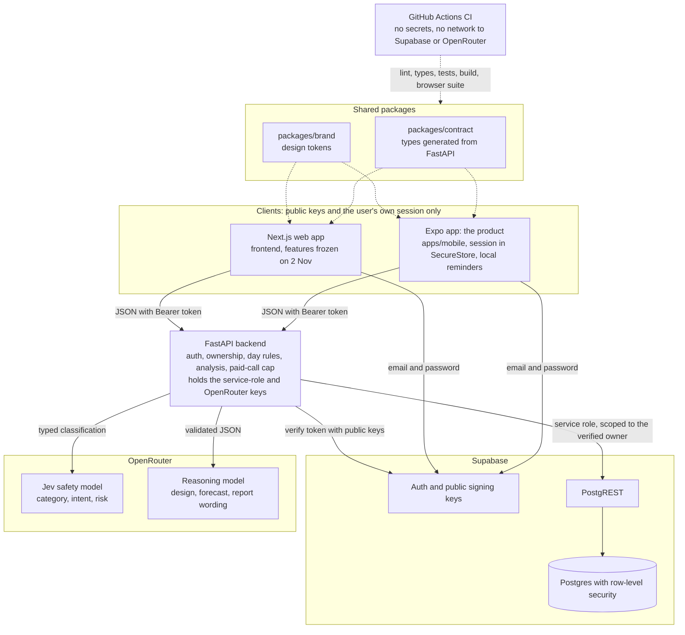
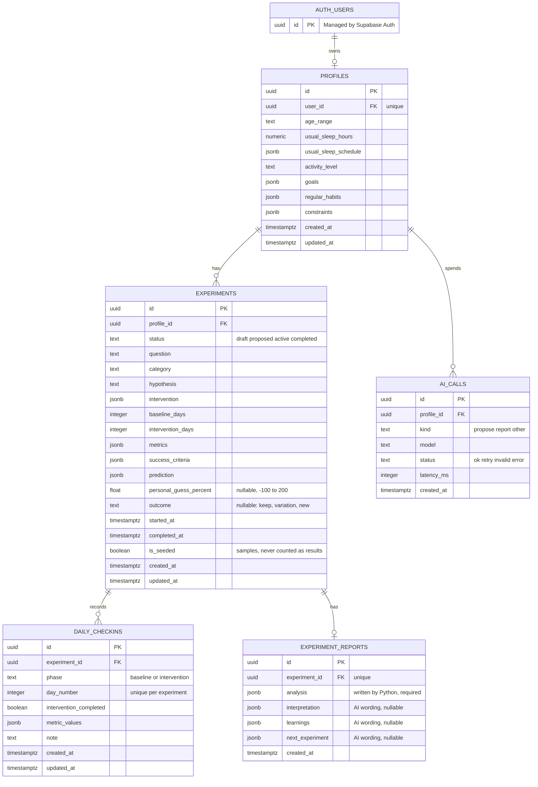
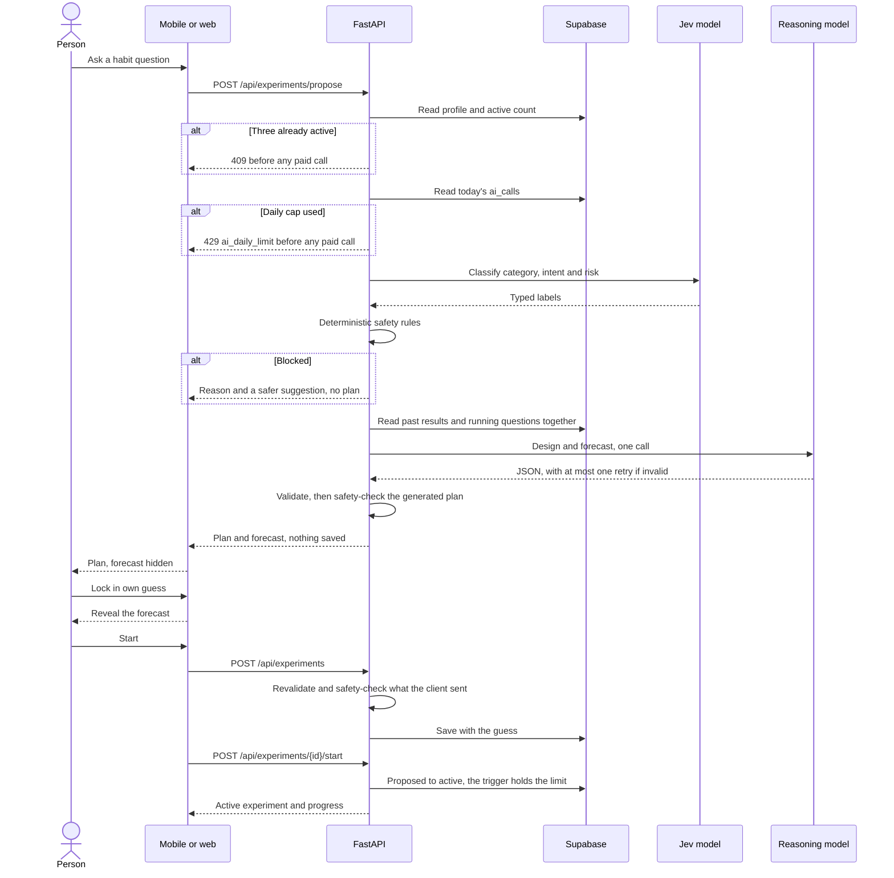
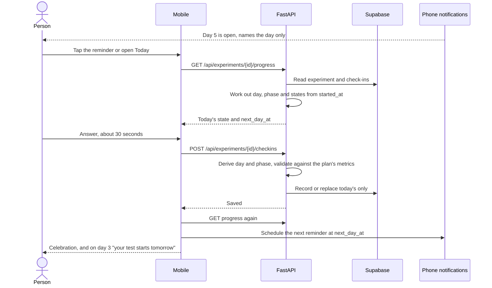
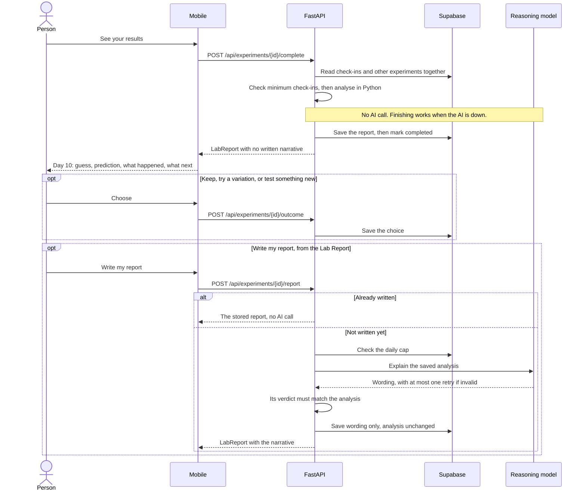
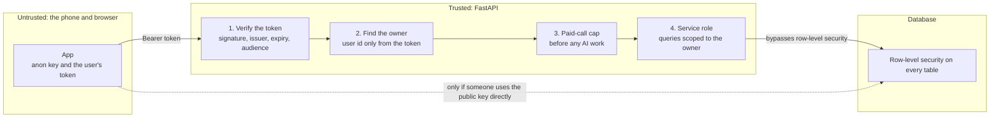

# Architecture

How Rhythm Health Lab is built, checked against `main` on **4 Nov 2026**. This describes the code in the repo, not a hosted service: the C2 demo runs on localhost with a shared Supabase project ([DECISIONS Q11](DECISIONS.md#questions-for-shakeb)). The reasons behind each choice are in the [ADRs](adr/README.md).

## 1. Requirements that shaped the design

| Requirement | What it means for the design |
|---|---|
| A person checks in daily for 10 days | Mobile first, with local reminders |
| Results must be honest | Python measures; the AI only proposes and explains |
| Health data, and logs are public | Keys stay on the backend; row-level security on every table; no prompts in logs |
| AI calls cost money | A per-person daily cap, checked before any paid work |
| Two people, about 10 days | A monorepo with generated types, no custom infrastructure |

**Scale today:** a handful of demo accounts. No load test has been run, so the [10x section](#7-scaling-and-failure-modes) is reasoning from the code, not measurement.

## 2. System

Clients never talk to the database for product data, and never talk to OpenRouter. The web and mobile apps are peers: both call the same API and read the same day rules. Mobile is the product, as 8x asked; the [deliberate differences](#8-deliberate-web-and-mobile-differences) are listed below.

| Area | Code |
|---|---|
| Routes, thin | [`backend/app/api/`](../backend/app/api/) |
| Logic | [`backend/app/services/`](../backend/app/services/), with [`analysis/`](../backend/app/services/analysis/) for the measurements |
| Database access | [`backend/app/repositories/`](../backend/app/repositories/) |
| External calls | [`backend/app/integrations/`](../backend/app/integrations/) |
| Row and API shapes | [`backend/app/schemas/`](../backend/app/schemas/) |
| Mobile | [`apps/mobile/src/`](../apps/mobile/src/), with data functions in [`lib/`](../apps/mobile/src/lib/) |
| Web | [`frontend/`](../frontend/) |

## 3. Data model

From [`supabase/migrations/`](../supabase/migrations/), not from inspecting the live project. Four records of what's applied: [#56](https://github.com/mnahsanofficial/rhythm-health/pull/56) (the first 8 files), [#71](https://github.com/mnahsanofficial/rhythm-health/pull/71) (2), [#80](https://github.com/mnahsanofficial/rhythm-health/pull/80) (1), and [DECISIONS](DECISIONS.md#new-supabase-project--4-nov-2026).

**Enforced by the database:**
- All foreign keys cascade on delete, so removing a person removes everything of theirs.
- At most three active experiments per profile, by a [trigger with a per-profile lock](../supabase/migrations/20261104000000_active_experiment_limit.sql), so two simultaneous starts can't both pass.
- One check-in per experiment per day, and one report per experiment.
- `ai_calls` never stores prompt or response text.

**Enforced in Python, not SQL:** what's inside the JSON columns, and which day is today.

**Computed, not stored:** progress and day states, chart data, and calibration.

**Rollbacks:** each migration has one in [`supabase/rollbacks/`](../supabase/rollbacks/). `20261028000000_initial_schema.sql` covers the first six files and refuses once any profile exists.

## 4. Key flows

### Propose: safety check, then design and forecast, then guess, then start

A failed start retries with the saved id, so it never creates a second experiment.

### Daily check-in

With two or more real experiments due, `GET` and `POST /api/checkins/today` make it one form. Questions combine only on an exact match of key, type, range and end words, and the save is all or nothing ([decision](DECISIONS.md#one-check-in-across-experiments--4-nov-2026)).

### Finish: analysis, the Day 10 choice, and the report written once

The Day 10 screen comes straight after the analysis and is free. Writing the report is a separate, optional, paid step, so the numbers are never held up by the AI.

## 5. Trust boundaries

| Boundary | Where it sits | What it protects |
|---|---|---|
| **Auth** | [`auth/supabase.py`](../backend/app/auth/supabase.py) checks each token against Supabase's public keys. The user id comes only from the token, never a request body | Acting as someone else |
| **Ownership** | [`api/deps.py`](../backend/app/api/deps.py) and the repositories scope every query to the verified profile | Reading someone else's experiment |
| **Service role** | Backend only. It bypasses row-level security, so the two checks above are what protect data on this path. CI and the apps never hold it | The whole database |
| **Row-level security** | On all five tables. People can read only their own rows; `ai_calls` has no policy at all, so only the service role reads it | Direct use of the public anon key |
| **Grants** | **Known gap:** Supabase's default grants leave `anon` and `authenticated` with wide table privileges (checked on `experiments`; `ai_calls` is already fixed), and row-level security is what blocks them. Tightening is [deferred](adr/0011-rls-and-deferred-grants.md) | Defence in depth |
| **Paid-call cap** | [`services/ai_limit.py`](../backend/app/services/ai_limit.py), before `/propose` and `POST /report` do paid work | Spending |
| **Safety** | [`services/safety.py`](../backend/app/services/safety.py) checks the question, the classification, the generated plan, and the plan again on save | Unsafe experiments |
| **Session on the phone** | Encrypted in SecureStore ([`secure-session-storage.ts`](../apps/mobile/src/lib/secure-session-storage.ts)) | A lost phone's session |
| **Notifications** | Name the day, never the habit question | The lock screen |
| **Logs** | One JSON line per request with the route template only, never the real path, query, headers or body. Sentry events drop request details | Tokens and personal notes |

## 6. AI: what it does, what it costs

**AI proposes, Python measures** ([ADR 3](adr/0003-ai-proposes-python-measures.md)). Results, verdicts, day states and calibration come from Python. The AI writes plans, forecasts and wording; prose numbers never feed a chart or a result.

| Action | Normal paid requests | Can reach | Counts against the cap |
|---|---|---|---|
| Propose an allowed question | 2: Jev, then design and forecast | 5, through a design retry and the Jev fallback | Yes, 5 per day. Jev isn't capped because it runs on every question |
| Question blocked by safety | 1: Jev | 3, through the Jev fallback | No |
| Save, start, check in, finish, read, Day 10 choice, samples | 0 | 0 | No |
| Write a report for the first time | 1 | 2, through one retry | Yes, 3 per day |
| Write a report already written | 0 | 0 | No |

The cap counts finished attempts, per person per UTC day. Timeouts and retries are explained in [ADR 8](adr/0008-async-openrouter-client.md).

## 7. Scaling and failure modes

### When something fails

| Failure | What happens | Gap |
|---|---|---|
| OpenRouter down or slow | Propose and writing a report return 503 with a retry. Check-ins, finishing and reading results all still work | None for the daily loop |
| Jev fails or returns nonsense | Falls back to the reasoning model for classification | Costs extra calls |
| Model returns invalid JSON | One retry, then 502 | The retry is paid for |
| Model call takes over 75 seconds | 503; not retried, since it was probably paid for | A real slow success now fails |
| Supabase down | 503; `/api/health` reports `degraded` | The cap can't be read, so calls go ahead |
| Finish fails between its two writes | The report is saved but the experiment stays active. Finishing again replaces the report | Not one transaction |
| Two report requests at once | Both can pass the check and both pay | No lock; the buttons guard against double taps |
| Two proposals at once at the cap | Both can pass | At most one extra call |
| Phone offline | Today shows the last loaded data, marked as such. Answers stay in memory and saving is disabled | Lost if the app is closed |
| App crashes on a phone | Nothing is reported | Mobile has no error reporting yet |

### What we'd change at 10x users

Listed in the order we'd expect them to matter:

1. **Host it.** Everything runs on localhost today. FastAPI needs a real host with HTTPS, and the apps need a fixed API URL and a built app rather than Expo Go.
2. **Mobile error reporting,** because crashes on people's phones are invisible today.
3. **Stop blocking threads on the database.** The Supabase client is blocking HTTP on worker threads, so a slow database still uses up the pool. Move to an async client.
4. **Share one HTTP client,** instead of one per AI call.
5. **A project-wide spend limit and alerts.** The cap is per person, so many new accounts could still spend without limit, and nothing alerts on the cost. Queue report writing rather than holding a request open for 10 seconds.
6. **Make the cap and report writing safe under races,** with a database lock or a unique attempt row.
7. **Tighten grants** and add a check for it in CI.
8. **Server-sent reminders.** Local notifications can't react to anything that happens after the app last ran.

Indexes aren't the first worry: reads are per person, and each person has a few experiments and about 10 check-ins each.

## 8. Deliberate web and mobile differences

**8x said daily tracking doesn't belong on a website, so mobile is the product.** Web features were frozen on 2 Nov, with bug fixes only ([MOBILE_PLAN](MOBILE_PLAN.md#full-app)). Both apps use the same API, so this is about screens, not rules.

| Mobile only | On web instead |
|---|---|
| Local reminders | A calendar file for the next day |
| First-run guide and check-in celebration | Saved confirmation |
| Day 3 "your test starts tomorrow" | Today shows the day and phase |
| Day 10 choice and "Habits I kept" | Finish opens the Lab Report |
| Lab Report opens with one plain sentence | Prediction versus reality comes first |
| Verdicts worded against normal ups and downs | Earlier verdict wording |
| "Where a question goes" trust line | None |

The web landing keeps its scrolling day story, and mobile has its own carousel. Bringing web level with mobile is [after the demo](REMAINING_WORK.md#after-the-demo).

## 9. Tests

CI runs on every PR and on `main` ([workflow](../.github/workflows/ci.yml)), with no secrets, so nothing in it can reach Supabase or OpenRouter. On `main` after #88: 466 backend, 244 web and 521 mobile unit tests all passed, plus the browser suite.

| Suite | Tools | Mocked |
|---|---|---|
| Backend | pytest | Supabase, OpenRouter; external requests are blocked |
| Web | Vitest, Testing Library, MSW | Auth, API |
| Browser | Playwright with real Next.js | Auth, API |
| Mobile | Jest, React Native Testing Library | Auth, API, storage, notifications |
| Contract and brand | Node | Fails if generated files drift |
| Logs | Node and Python | Fails on any drift from the guide's format |
| Migrations | Disposable Postgres scripts in [`backend/tests/migrations/`](../backend/tests/migrations/) | Supabase's roles and defaults, as far as modelled |

**CI can't cover:** real sign-in, real AI output, VoiceOver, real large text, reminders, and the installed app's splash. Those are checked by hand on an iPhone; each PR says what was checked. Rules: [testing](rules/testing.md).
