# 7. Feedback from the 5 Nov demo call

Maham (8x) watched the mobile app on the demo call on 5 Nov 2026. The quotes come from Nazmul's notes of the call, and there's no transcript in the repo. The synthesis is [round 3 in 04-synthesis.md](04-synthesis.md#round-3-the-8x-demo-call-n1-outside-reviewer).

## What she said

- "The main thing with the whole application is cognitive overload."
- "There's too much text written in too many different places, and a lot of it is not readable because it's grey."
- "The today check-in screen is asking you so many questions on one screen. Maybe it asks you one question, you answer that, then the second question."
- "Day 1 of 10 baseline, and underneath it says 'Day 1 recorded'. Not important. Maybe just a check somewhere to show it's recorded."
- "'Spend 10 minutes outdoors in natural daylight': we don't need it on the screen. You can click it and see it on the next screen."
- "The screen which shows you the experiment, there was too much text there."
- "People are used to skimming. Structure the information so it's digestible for a first-time user."
- "How are you ensuring the experiments are actually going to help someone?"

## What we changed

| She said | What changed | PR |
|---|---|---|
| Too many questions on one screen | One question per screen, with auto-advance, Back and a review | [#102](https://github.com/mnahsanofficial/rhythm-health/pull/102) |
| "Day 1 recorded" isn't important | A check icon on the day | [#103](https://github.com/mnahsanofficial/rhythm-health/pull/103) |
| The small change needn't be on screen | One "Today's change ›" row that opens a sheet | [#103](https://github.com/mnahsanofficial/rhythm-health/pull/103) |
| Too much text on the experiment screen | Status, next action and timeline, with the rest behind rows; the plan is 4 short steps | [#103](https://github.com/mnahsanofficial/rhythm-health/pull/103), [#104](https://github.com/mnahsanofficial/rhythm-health/pull/104) |
| Too much text, everywhere | A word budget per screen, enforced by a test | [#102](https://github.com/mnahsanofficial/rhythm-health/pull/102) to [#105](https://github.com/mnahsanofficial/rhythm-health/pull/105) |
| Grey isn't readable | Grey is for short captions only, enforced by a test. The token didn't change, because it already passed AA | [#105](https://github.com/mnahsanofficial/rhythm-health/pull/105) |
| How do you ensure it helps? | The plan says "Your check-ins decide, not the AI", and the report opens "How we know ›". We make no promise that a change helps | [#106](https://github.com/mnahsanofficial/rhythm-health/pull/106) |

## Word counts

Counted by rendering each screen in the test suite with fixture data: words containing a letter, without the tab bar or brand name, including text below the fold. "After" is the budget in `apps/mobile/__tests__/word-budget.test.tsx`, so a screen can be under it. Real AI text will vary.

| Screen | Before | After | Plan target |
|---|---|---|---|
| Today, due | 40 | 26 | 25 |
| Today, recorded | 31 | 23 | 25 |
| Today, two running | 54 | 42 | 40 |
| Check-in, test day | 55 on one screen | 15 change, 12 per question, 20 review | Same |
| Check-in, baseline day | 36 on one screen | 12 per question, 20 review | Same |
| Combined check-in | 77 on one screen | 16 per step, 25 review | Same |
| Ask | 69 | 41 | 40 |
| Guess | 27 | 15 | 15 |
| Plan | 60 on one screen | 12 change, 16 reveal, 25 days | 12, 15, 25 |
| Experiment screen | 137 | 35 | 35 |
| Lab Report | 371 | 50 (62 after Compare) | 50 |
| Progress | 101 with a day open | 40 | 40 |
| History, one row | 62 | 30 | 30 |

**Over target:** Today by 1 and 2 ("Closes …" and "Also running" were kept), Ask by 1, and the reveal by 1 ("to" in "+8% to +15%" counts as a word).

## Before and after

Expo web, 390 wide, sample data, every call mocked.

| | Before | After, light | After, dark |
|---|---|---|---|
| Today | 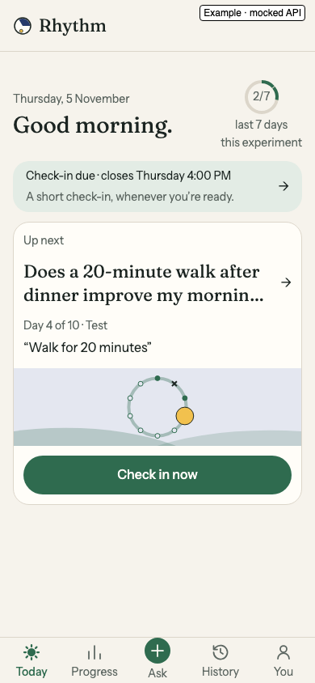 | 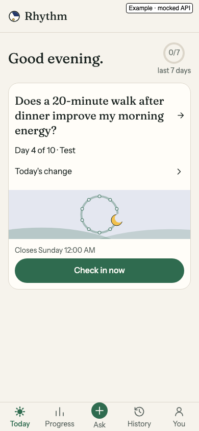 | 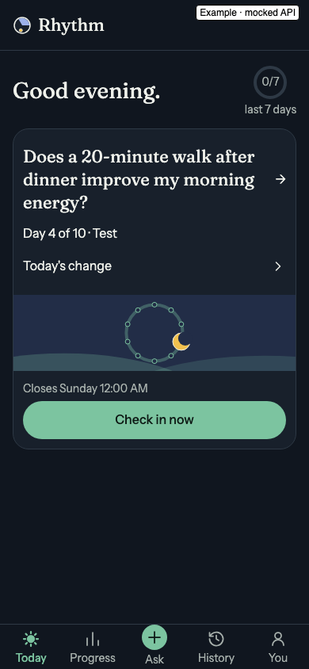 |
| Check-in | 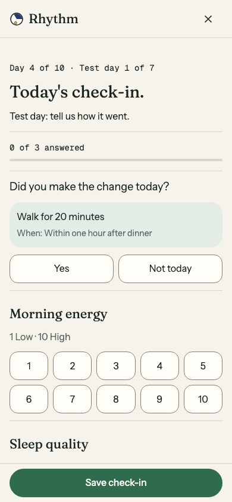 | 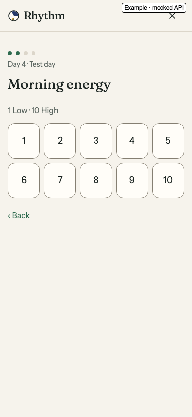 | 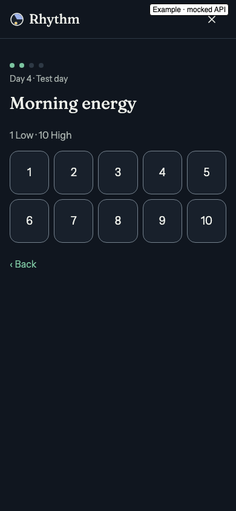 |
| Plan | No saved screenshot of the one-screen plan | 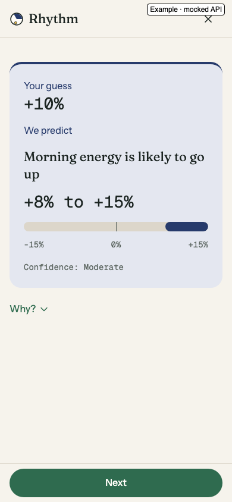 | 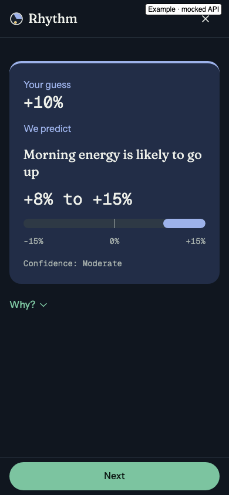 |
| Lab Report | 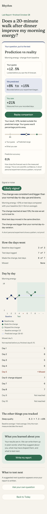 | 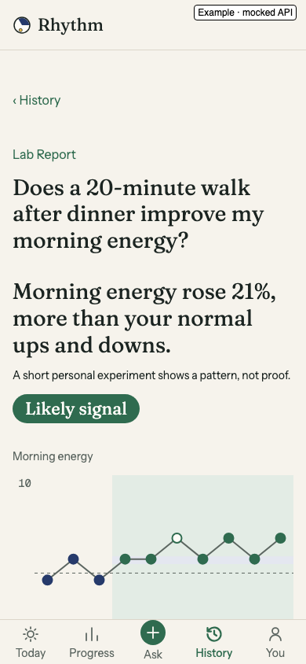 | 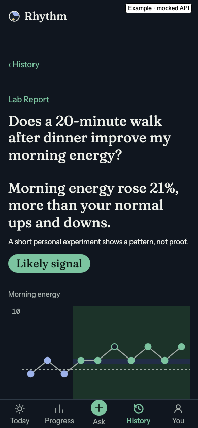 |

The full set is in [`docs/screenshots/mobile-feedback-5-nov/`](../screenshots/mobile-feedback-5-nov/), made with `apps/mobile/scripts/capture-feedback.cjs`.

## What this doesn't show

No outside user has tried it, so we don't know yet whether a first-time user finds it easier, or whether one question per screen stays quick by day 7. Nazmul's full iPhone pass is on the morning of 6 Nov. The web app keeps its old screens.
